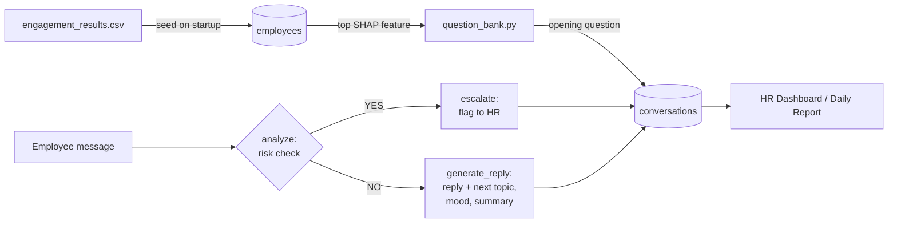

# ⚡ VibeMeter

> **AI-Powered Employee Engagement & Risk Mitigation System**
> Turns SHAP-based attrition risk signals into proactive, empathetic check-in conversations, with real-time HR escalation.

VibeMeter closes the gap between predictive HR analytics and actual human follow-up. An upstream ML model flags employees who may be disengaged and explains *why* using SHAP feature attributions. VibeMeter takes those results and starts a short, empathetic check-in with each employee through **TIA**, the People Experience assistant. Questions are tailored to the biggest driver of that employee's risk score, and anything serious is escalated to HR.

---

## 🌐 Live Deployments

- **Frontend Application:** [https://vibemeter-ai-engagement-1.onrender.com](https://vibemeter-ai-engagement-1.onrender.com)
- **Backend API Service:** [https://vibemeter-ai-engagement-n2r8.onrender.com](https://vibemeter-ai-engagement-n2r8.onrender.com) · interactive docs at [`/docs`](https://vibemeter-ai-engagement-n2r8.onrender.com/docs)

> Both services are on Render's free tier, so the first request after a period of inactivity can take up to a minute while the backend wakes up.

---

## ✨ Key Features

- 🎯 **SHAP personalisation**: each flagged employee's top SHAP feature (e.g. long work hours, a long gap since their last reward) picks the opening question.
- 🧭 **Multi-topic check-ins**: the agent tracks which topics have been covered and which are left, asks about one at a time, and won't close the conversation until at least two topics are covered.
- 🛡️ **Autonomous HR escalation**: every message is checked for severe distress, harassment or toxicity. Once a conversation is flagged, it stays flagged.
- 📊 **Live HR dashboard**: a password-protected table of every conversation, escalated first, with an LLM-written "Issues Raised" summary for each.
- 💾 **Session resilience**: conversations, mood and topic progress are saved in MongoDB, and employees can resume at any time.
- 🤝 **Open to everyone**: employees who weren't flagged still get a general wellbeing check-in.
- 🔄 **Idempotent data seeding**: the SHAP CSV is upserted on startup without creating duplicates.
- 📝 **Daily HR report**: one endpoint summarises all conversations, gives each an action item, and writes the result to `hr_daily_report.json`.

---

## 🛠️ How It Works



1. **Seeding**: on startup, `backend/main.py` reads the CSV at `ENGAGEMENT_CSV_PATH`, keeps rows where `is_selected` is `TRUE`, and upserts them into the `employees` collection.
2. **SHAP parsing**: `shap_service.py` parses each `shap_values` string (e.g. `"Average_Vibe_Score(0.0323), Total_Reward_Points(0.0290), ..."`) and sorts the features by absolute impact.
3. **Opening question**: the top feature is looked up in `app/data/question_bank.py` to choose a hand-written opener. Employees who weren't flagged get a general check-in. Every other question-bank topic goes on the conversation's `remaining_topics` list.
4. **Conversation**: each reply runs through the LangGraph workflow in `app/agent/`:
   - `analyze` asks the LLM for a YES/NO decision on whether the message shows severe distress, harassment or toxicity.
   - `escalate` tells the employee their concern is being flagged confidentially to HR.
   - `generate_reply` asks the LLM for structured JSON: `bot_reply`, `should_continue`, `topic_covered`, `mood` and `concern_summary`. It then updates topic progress and the HR summary.
5. **Closing**: the conversation ends when the agent sets `should_continue` to false, or when the employee clicks *End Chat*, which calls `/end_chat` and marks the conversation `closed`.

---

## 🧱 Tech Stack

| Layer | Stack | Purpose |
|---|---|---|
| **Backend** | FastAPI + Uvicorn | Async API service |
| **AI Agent** | LangGraph + `llama-3.3-70b-versatile` via Groq | Conversation routing, risk evaluation, summaries |
| **Database** | MongoDB (Motor async driver) | Employee profiles and persistent chat state |
| **Data** | Pandas + regex SHAP parsing | CSV ingestion |
| **Frontend** | React 19 + Vite + Axios | Chat interface and HR dashboard |
| **Hosting** | Render (`render.yaml` blueprint) | Backend web service + static frontend |

---

## 📂 Project Structure

```
.
├── backend/
│   ├── main.py                    # FastAPI app: lifespan (DB connect + CSV seed), CORS, router
│   ├── requirements.txt
│   ├── .env.example
│   ├── data/
│   │   └── engagement_results.csv # Input: employee IDs, selection flag, SHAP attributions
│   └── app/
│       ├── config.py              # Environment variable loading
│       ├── database.py            # Motor client; `employees` + `conversations` collections
│       ├── agent/
│       │   ├── llm.py             # Groq LLM instance
│       │   ├── prompts.py         # Risk-assessment and multi-topic reply prompts
│       │   ├── nodes.py           # analyze / generate_reply / escalate nodes + routing
│       │   └── workflow.py        # LangGraph graph compilation
│       ├── data/question_bank.py  # SHAP feature → opening / follow-up questions
│       ├── models/                # ChatState, ChatRequest, HrLoginRequest
│       ├── routes/                # outreach, chat, report, hr routers
│       └── services/              # SHAP parsing, agent input building, HR token check
├── frontend/
│   ├── src/
│   │   ├── App.jsx                # Outreach panel, chat UI, HR login modal + dashboard
│   │   ├── App.css
│   │   ├── index.css
│   │   └── main.jsx
│   ├── index.html
│   ├── package.json
│   └── vite.config.js
└── render.yaml                    # Render blueprint for backend + frontend
```

---

## 🚀 Quick Start (Local)

### Prerequisites

- Python 3.10+
- Node.js 20.19+ (the frontend uses a Vite 8 beta)
- MongoDB: a local instance on `mongodb://localhost:27017` or a MongoDB Atlas cluster
- A [Groq API key](https://console.groq.com/) (the free tier works)

### 1. Backend

```bash
cd backend
python -m venv .venv
source .venv/bin/activate        # Windows: .venv\Scripts\activate
pip install -r requirements.txt
cp .env.example .env             # then fill in the values below
uvicorn main:app --reload --port 8000
```

When the backend starts you should see `✅ SUCCESS: Connected to MongoDB`. Interactive API docs are at `http://127.0.0.1:8000/docs`.

### 2. Frontend

```bash
cd frontend
npm install
npm run dev
```

Open [http://localhost:5173](http://localhost:5173). The frontend calls `VITE_API_BASE_URL` and falls back to `http://127.0.0.1:8000`.

---

## ⚙️ Environment Configuration

**Backend** (`backend/.env`):

| Key | Description | Default |
|---|---|---|
| `GROQ_API_KEY` | Groq API key for LLM inference. The backend won't start without it. | *(required)* |
| `MONGODB_URI` | MongoDB connection string | `mongodb://localhost:27017` |
| `MONGODB_DB` | Database name | `vibemeter` |
| `HR_PASSWORD` | Password for the HR portal and dashboard | *(required for HR features)* |
| `ENGAGEMENT_CSV_PATH` | Path to the SHAP engagement CSV, relative to `backend/` | `data/engagement_results.csv` |

**Frontend** (`frontend/.env`, optional):

| Key | Description | Default |
|---|---|---|
| `VITE_API_BASE_URL` | Full backend URL, **including `https://`**. Vite bakes it in at build time. | `http://127.0.0.1:8000` |

---

## 🧑‍💻 Using the App

**As an employee**

1. Optionally click **Trigger Daily Data Load** to simulate the outreach batch job.
2. Enter an employee ID (e.g. `EMP0345`, which is flagged in the CSV) and click **Start Chat**.
3. Reply to TIA. It works through a few topics, starting with your main SHAP driver. If a message reads as distressed or describes harassment or toxicity, the bot escalates to HR.
4. Click **End Chat** to close the session. Entering the same ID again resumes the conversation.

**As HR**

1. Click **🔒 HR Login** in the header and enter `HR_PASSWORD`.
2. The dashboard lists every conversation: Employee ID, Top SHAP Feature, Status (💬 Active / 🚨 Escalated), and **Issues Raised** (the LLM summary). Escalated employees are listed first.
3. Use ↺ to refresh and ⏻ to log out.

---

## 📡 API Reference

| Method | Endpoint | Auth | Description |
|---|---|---|---|
| `GET` | `/trigger_outreach` | — | Lists all flagged employees with their ranked SHAP features |
| `POST` | `/start_chat/{employee_id}` | — | Starts or resumes a conversation; returns the opening (or last) bot message |
| `POST` | `/chat` | — | Sends a message through the agent; returns `bot_reply`, `escalated`, `should_continue` and `mood` |
| `POST` | `/end_chat/{employee_id}` | — | Marks the conversation as `closed` |
| `GET` | `/generate_daily_report` | — | Summarises all conversations and writes `hr_daily_report.json` |
| `POST` | `/auth/hr/login` | — | Checks the HR password and returns a token |
| `GET` | `/dashboard/employees` | `X-HR-Token` | Aggregated conversation data for the HR dashboard |

### Examples

```bash
API=http://127.0.0.1:8000

# Start (or resume) a chat
curl -X POST $API/start_chat/EMP0345

# Send a message
curl -X POST $API/chat \
  -H "Content-Type: application/json" \
  -d '{"employee_id": "EMP0345", "message": "Honestly things have been pretty stressful lately."}'
# → {"bot_reply": "...", "escalated": false, "should_continue": true, "mood": "negative"}

# HR login, then fetch the dashboard
curl -X POST $API/auth/hr/login \
  -H "Content-Type: application/json" \
  -d '{"password": "your-hr-password"}'
curl $API/dashboard/employees -H "X-HR-Token: your-hr-password"
```

---

## 🗃️ Data Format

`backend/data/engagement_results.csv` is the output of the upstream engagement model:

| Column | Example | Notes |
|---|---|---|
| `employee_id` | `EMP0345` | Unique employee identifier |
| `is_selected` | `TRUE` | Only `TRUE` rows are seeded for outreach |
| `shap_values` | `"Average_Vibe_Score(0.0323), Total_Reward_Points(0.0290), ..."` | Comma-separated `feature(value)` pairs; scientific notation supported |

Topics in the question bank: `Average_Work_Hours`, `Days_since_last_leave`, `Total_Reward_Points`, `Days_since_last_reward`, `Latest_Promotion_Consideration`, `Average_Team_Messages_Sent`, `Average_Manager_Feedback_Score`, `Average_Vibe_Score`. To support a new feature, add an entry to `QUESTION_BANK`.

**MongoDB collections**

- **`employees`**: `{ employee_id, top_impact_features }`
- **`conversations`**: `{ employee_id, primary_issue, messages[], escalate_to_hr, vibe_summary, is_flagged, should_continue, mood, conversation_status, covered_topics[], remaining_topics[] }`

---

## ☁️ Deployment (Render)

`render.yaml` defines both services, so you can deploy everything from one Blueprint:

1. **MongoDB Atlas**: create a cluster, create a database user, and under *Network Access* allow `0.0.0.0/0` (Render's outbound IPs aren't fixed). Copy the `mongodb+srv://...` connection string.
2. **Render**: go to *New → Blueprint* and select this repo. Render reads `render.yaml` and creates:
   - `vibemeter-backend`: a Python web service with `rootDir: backend`, started with `uvicorn main:app --host 0.0.0.0 --port $PORT`
   - `vibemeter-frontend`: a static site with `rootDir: frontend` that publishes `dist/`, with SPA rewrites to `index.html`
3. **Secrets**: when prompted, set `GROQ_API_KEY`, `MONGODB_URI` and `HR_PASSWORD` on the backend.
4. **Frontend API URL**: the blueprint wires `VITE_API_BASE_URL` to the backend's `host` property, which is a bare hostname **without `https://`**. Axios would treat that as a relative path. Override `VITE_API_BASE_URL` on the frontend service with the full URL (e.g. `https://vibemeter-backend.onrender.com`), then redeploy the frontend so the value is baked into the build.
5. **Verify**: open `<backend-url>/docs`, check the logs for the MongoDB success message, then open the frontend and start a chat.

Once the services are connected, pushing to `main` triggers automatic redeploys.

---

## ⚠️ Known Limitations

- **Simple HR auth**: the HR token *is* the password, sent in a header. Replace it with signed JWTs before any real use.
- **Unprotected endpoints**: `/trigger_outreach`, `/start_chat`, `/chat`, `/end_chat` and `/generate_daily_report` don't require authentication, and employee IDs aren't validated or verified.
- **Open CORS**: `allow_origins=["*"]` should be restricted to the frontend's origin, especially because this app handles sensitive wellbeing data.
- **Ephemeral report file**: `hr_daily_report.json` is written to the server's local disk, which Render wipes on every deploy and restart.
- **LLM-based risk check**: escalation depends on a single YES/NO LLM classification. It can produce false positives and false negatives and doesn't replace human judgement.

---

## 📄 License

Internal / academic project. No license specified.
