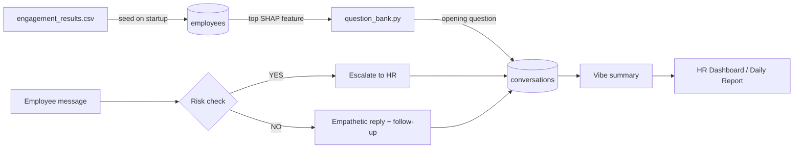

# VibeMeter — AI Employee Engagement Bot

**Proactive employee check-ins, driven by SHAP explanations and an LLM agent, with an HR dashboard for follow-up.**

VibeMeter closes the gap between predictive HR analytics and actual human follow-up. An upstream ML model flags employees who may be disengaged and explains *why* using SHAP feature attributions. VibeMeter takes those results and starts a short, empathetic check-in with each employee through **TIA**, the People Experience assistant. Questions are tailored to the biggest driver of that employee's risk score, and anything serious is escalated to HR.

---

## Features

- **SHAP-driven openers**: each flagged employee's top SHAP feature (for example long work hours or a long gap since their last reward) picks the first question they see.
- **LangGraph conversation agent**: every message goes through a risk check first. Signs of severe distress, harassment or toxicity trigger escalation; otherwise the LLM writes a supportive reply with one follow-up question.
- **Persistent conversations**: employee data and chat state live in MongoDB, so a conversation picks up where it left off after a page reload or server restart.
- **Open to everyone**: employees who weren't flagged can still chat. They get a general wellbeing check-in instead of a targeted one.
- **Live "Issues Raised" summaries**: after every message, the LLM writes a one-sentence summary of the employee's concern and mood for HR.
- **HR dashboard**: password-protected table of every conversation, with escalated employees listed first.
- **Daily HR report**: a single endpoint summarises all conversations, gives each one an action item, and writes the result to `hr_daily_report.json`.

---

## How it works



1. **Seeding**: on startup the backend reads `engagement_results.csv`, keeps rows where `is_selected` is `TRUE`, and upserts them into the MongoDB `employees` collection. Re-running doesn't create duplicates.
2. **SHAP parsing**: each `shap_values` string (e.g. `"Average_Vibe_Score(0.0323), Total_Reward_Points(0.0290), ..."`) is parsed and sorted by absolute impact.
3. **Opening question**: the top feature is looked up in `question_bank.py` to choose a hand-written opener. Employees who weren't flagged get a general check-in.
4. **Conversation**: each reply runs through the LangGraph state machine in `agent.py`:
   - `analyze` asks the LLM whether the message shows severe distress, harassment or toxicity (YES/NO).
   - `escalate` tells the employee their concern is being flagged confidentially to HR. Once a conversation is escalated, it stays escalated.
   - `generate_reply` writes a short, supportive response that asks exactly one follow-up question.
5. **Summarise & report**: a new vibe summary is saved after every turn. HR sees these on the dashboard or pulls the full daily report.

---

## Tech stack

| Layer | Tech |
|---|---|
| API | FastAPI + Uvicorn |
| Agent orchestration | LangGraph + LangChain Core |
| LLM | `llama-3.3-70b-versatile` via Groq (`langchain-groq`) |
| Database | MongoDB via Motor (async driver) |
| Data processing | Pandas, regex-based SHAP parsing |
| Frontend | React 19 + Vite, Axios, plain CSS |
| Deployment | Render (`render.yaml`) |

---

## Project structure

```
.
├── main.py                  # FastAPI app: lifespan (DB connect + CSV seed), routes, HR auth
├── agent.py                 # LangGraph state machine (analyze → reply | escalate) + Groq LLM
├── database.py              # Motor client; `employees` and `conversations` collections
├── question_bank.py         # SHAP feature → opening / follow-up question mapping
├── engagement_results.csv   # Input: employee IDs, selection flag, SHAP attributions
├── requirements.txt         # Python dependencies
├── render.yaml              # Render blueprint for the backend
├── .env.example             # Environment variable template
├── babysteps.md             # Development roadmap / design notes
└── frontend/
    ├── src/
    │   ├── App.jsx          # Outreach panel, chat UI, HR login modal + dashboard
    │   ├── App.css
    │   ├── index.css
    │   └── main.jsx
    ├── index.html
    ├── package.json
    └── vite.config.js
```

---

## Getting started

### Prerequisites

- Python 3.10+
- Node.js 20.19+ (the frontend uses a Vite 8 beta)
- MongoDB: a local instance on `mongodb://localhost:27017` or a MongoDB Atlas cluster
- A [Groq API key](https://console.groq.com/) (the free tier works)

### 1. Configure environment

Copy `.env.example` to `.env` in the project root and fill it in:

```env
GROQ_API_KEY=gsk_your_key_here
MONGODB_URI=mongodb://localhost:27017
HR_PASSWORD=choose-a-strong-password
```

| Variable | Required | Description |
|---|---|---|
| `GROQ_API_KEY` | Yes | Used by the LangGraph agent and summaries. The backend won't start without it. |
| `MONGODB_URI` | No | MongoDB connection string. Defaults to `mongodb://localhost:27017`. The database name is always `vibemeter`. |
| `HR_PASSWORD` | For HR features | Password for the HR portal and dashboard. |

### 2. Run the backend

```bash
python -m venv .venv
source .venv/bin/activate        # Windows: .venv\Scripts\activate
pip install -r requirements.txt
uvicorn main:app --reload --port 8000
```

On startup you should see `✅ Connected to MongoDB` and `✅ Seeded N flagged employees into MongoDB.` Interactive API docs are at `http://127.0.0.1:8000/docs`.

### 3. Run the frontend

```bash
cd frontend
npm install
npm run dev
```

The app runs at `http://localhost:5173`. The backend URL is hardcoded as `API_BASE_URL` in `frontend/src/App.jsx` (default `http://127.0.0.1:8000`). Change it if your backend runs somewhere else.

---

## Using the app

**As an employee**

1. Optionally click **Trigger Daily Data Load** to simulate the outreach batch job.
2. Enter an employee ID (e.g. `EMP0345`, which is flagged in the CSV) and click **Start Chat**.
3. Reply to TIA. If a message reads as distressed or describes harassment or toxicity, the bot escalates the conversation to HR.
4. Entering the same ID again resumes the existing conversation.

**As HR**

1. Click **🔒 HR Login** in the header and enter `HR_PASSWORD`.
2. The dashboard lists every conversation: Employee ID, Top SHAP Feature, Status (💬 Active / 🚨 Escalated), and **Issues Raised** (the LLM summary). Escalated employees are listed first.
3. Use ↺ to refresh and ⏻ to log out.

---

## API reference

| Method | Endpoint | Auth | Description |
|---|---|---|---|
| `GET` | `/trigger_outreach` | — | Lists all flagged employees with their ranked SHAP features |
| `POST` | `/start_chat/{employee_id}` | — | Starts or resumes a conversation; returns the opening (or last) bot message |
| `POST` | `/chat` | — | Sends an employee message through the agent; returns the reply and escalation flag |
| `GET` | `/generate_daily_report` | — | Summarises all conversations and writes `hr_daily_report.json` |
| `POST` | `/auth/hr/login` | — | Checks the HR password and returns a token |
| `GET` | `/dashboard/employees` | `X-HR-Token` | Aggregated conversation data for the HR dashboard |

### Examples

```bash
# Start (or resume) a chat
curl -X POST http://127.0.0.1:8000/start_chat/EMP0345

# Send a message
curl -X POST http://127.0.0.1:8000/chat \
  -H "Content-Type: application/json" \
  -d '{"employee_id": "EMP0345", "message": "Honestly things have been pretty stressful lately."}'
# → {"bot_reply": "...", "escalated": false}

# HR login, then fetch the dashboard
curl -X POST http://127.0.0.1:8000/auth/hr/login \
  -H "Content-Type: application/json" \
  -d '{"password": "your-hr-password"}'
curl http://127.0.0.1:8000/dashboard/employees -H "X-HR-Token: your-hr-password"
```

---

## Data format

`engagement_results.csv` is the output of the upstream engagement model:

| Column | Example | Notes |
|---|---|---|
| `employee_id` | `EMP0345` | Unique employee identifier |
| `is_selected` | `TRUE` | Only `TRUE` rows are seeded for outreach |
| `shap_values` | `"Average_Vibe_Score(0.0323), Total_Reward_Points(0.0290), ..."` | Comma-separated `feature(value)` pairs; scientific notation supported |

Features with a hand-written opener in `question_bank.py`:
`Average_Work_Hours`, `Days_since_last_leave`, `Total_Reward_Points`, `Days_since_last_reward`, `Latest_Promotion_Consideration`, `Average_Team_Messages_Sent`, `Average_Manager_Feedback_Score`, `Average_Vibe_Score`. Any other top feature gets a generic check-in. To support a new feature, add an entry to `QUESTION_BANK`.

### MongoDB collections (`vibemeter` database)

- **`employees`**: `{ employee_id, top_impact_features }`
- **`conversations`**: `{ employee_id, primary_issue, messages[], escalate_to_hr, vibe_summary, is_flagged }`

---

## Deployment

The backend has a Render blueprint (`render.yaml`):

- **Build:** `pip install -r requirements.txt`
- **Start:** `uvicorn main:app --host 0.0.0.0 --port $PORT`
- **Env vars to set in the Render dashboard:** `GROQ_API_KEY`, `MONGODB_URI` (e.g. MongoDB Atlas), `HR_PASSWORD`

The frontend is a static Vite build (`npm run build` → `frontend/dist`) and can be hosted on any static host. Point `API_BASE_URL` in `App.jsx` at the deployed backend before building.

---

## Known limitations

- **Simple HR auth**: the HR token *is* the password, sent in a header. Replace it with signed JWTs before any real use.
- **Unprotected endpoints**: `/trigger_outreach`, `/start_chat`, `/chat` and `/generate_daily_report` don't require authentication, and employee IDs aren't validated or verified.
- **Open CORS**: `allow_origins=["*"]` is fine for development but should be locked down, especially because this app handles sensitive wellbeing data.
- **Hardcoded API URL**: the frontend backend URL isn't read from an environment variable yet.
- **LLM-based risk check**: escalation depends on a single YES/NO LLM classification. It can produce false positives and false negatives and doesn't replace human judgement.

See [`babysteps.md`](babysteps.md) for the planned roadmap (employee ID validation, routed login screens, and more).

---

## License

Internal / academic project. No license specified.
